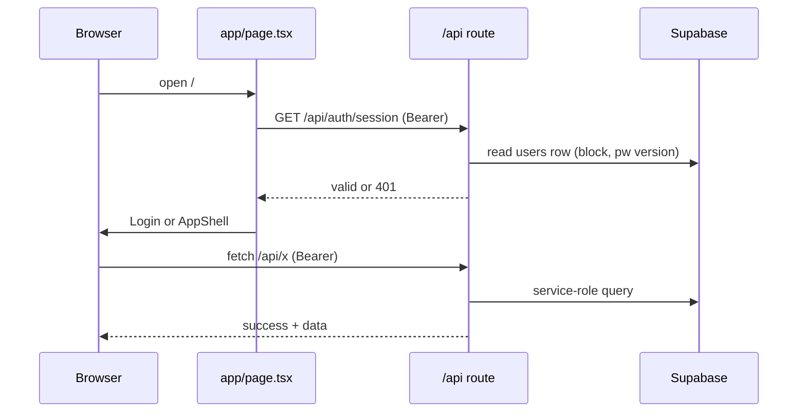

# Request Flow
**One line: the whole UI is one client page; screens are a `view` string in `AppShell`, and each screen fetches `/api/*` with a Bearer token.**

## Key facts
- Only one page exists: `app/page.tsx` (`'use client'`).
- No `middleware.ts` / `proxy.ts` in the repo root. Nothing guards routes before they run.
- Token storage: `localStorage` key `ngf_token` (`app/page.tsx:141,164`). Device-trust token: `ngf_qrtrust` (`components/Login.tsx:40`).
- Every API call sends `Authorization: Bearer <token>`. Auth cookies are not used for sessions. Only the CSRF cookie is set (`lib/csrf.ts:40`).
- API replies use `{ success, data }` or `{ success: false, error }` (`lib/api.ts:45-51`).

## How it works
1. Page load (`app/page.tsx:138-161`): read `ngf_token`, decode the payload in the browser (`atob`), drop it if `exp` passed. If valid, call `GET /api/auth/session`. A 401 deletes the token. Offline keeps the session.
2. No session: render `<Login>`. On success `onLogin` stores the token (`app/page.tsx:163`).
3. Role `NGF AGENT`: show the `AttendanceModal` first (GPS, `POST /api/agent/attendance`). "Skip for Now" is allowed (`app/page.tsx:67`).
4. Otherwise render `<AppShell session onLogout>`. It picks the first menu item as the start view. Staff start on `notifications`, then switch to their first granted feature after `GET /api/branches?self=1` (`components/AppShell.tsx:111,125-137`).
5. `renderPage()` is a big `switch (view)` returning a page component (`components/AppShell.tsx:159`). Pages receive `session` and call APIs themselves.
6. Server side: each route is wrapped in `apiHandler`, calls `getSession` / `requireRole`, then reads tables through `lib/supabase-db.ts`.

## Rules and gotchas
- Role is decoded from the JWT in the browser to build the menu. That is display only; the server re-checks. See [[Roles and Permissions]].
- Many views in the `switch` have no menu item (orphans). See [[Screens Map]].
- Notification bell dropdowns in `AppShell` show hard-coded sample items and a fixed badge "3" (`components/AppShell.tsx:348,365-389`). Real data lives on the Notifications screen.
- Error to status mapping is by message text: `No permission` 403, `No token provided` / `Session expired` 401, everything else 400 (`lib/api.ts:59`).
- A blocked user gets a 400 with a block message, not 401 (`lib/api.ts:31-34`).
- Dark mode flag `ngf_dark_mode` in localStorage toggles class `ngf-dark` (`AppShell.tsx:121`).

## Related
- [[Architecture Brain]], [[Auth and Sessions]], [[Data Access Layer]], [[Screens Map]], [[Mobile and Responsive Notes]]
