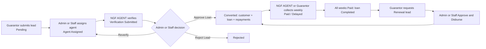

# Loan Lifecycle Brain
**One-page map of how a lead becomes a customer, a loan and a weekly repayment schedule, and how it renews.**

Purpose: explain each step, who does it, and which route and page does the work. Money rules live in [[Loan Products and Math]]; collections in [[Repayments and Collections]].

## Five things to remember
1. A customer row is created only at approval (`approveLoan`), not at lead time. See [[Lead to Loan]].
2. Approval writes 1 customer, 1 loan and N repayment rows (N = weeks), starting the next Saturday (IST).
3. Renewal is a lead with `Loan Product = RENEWAL`. Eligibility is checked only in the browser. See [[Renewals]].
4. `loans.customer_id` is UNIQUE in `supabase_schema.sql:182`, so a second loan row for one customer is blocked unless the live DB differs.
5. Lead photos live in Google Drive; payment proofs and profile photos live in Supabase Storage. See [[Verification and Documents]].

## Flow

## Notes in this section
| Note | What it answers | Read when |
|---|---|---|
| [[Lead to Loan]] | Statuses, routes, rows written at approval | Debugging a stuck lead or approval |
| [[Loan Products and Math]] | 10K10W, custom products, schedule maths | Changing a product or amount |
| [[Verification and Documents]] | Agent form, photos, Drive vs Supabase, reviews | Photos missing, rating questions |
| [[Renewals]] | RENEWAL lead, eligibility, approveRenewal | Renewal fails or is wrongly allowed |
| [[Customer History and Score]] | Loan account number, per-loan payment history with recorded time, repayment score | Touching loan numbers, payment history or the score |
| [[Customers and Import]] | Scoping, My Customers, import, delete cascade | Customer visibility or legacy data |
| [[Guarantors and Cheques]] | Guarantor create/edit, branch link, cheques page | Guarantor accounts, cheque page empty |

## Known issues
- Lead stuck at `Approved` if `approveLoan` throws (no button to retry). See [[Lead to Loan]].
- Custom loan products cannot be picked on the submit-lead or import forms. See [[Loan Products and Math]].
- Cheques Pledged page is unreachable and always empty. See [[Guarantors and Cheques]].
- Role and status checks on API routes: [[Open Security Leads]].

## Update this section when ...
- `app/api/leads/[leadId]/route.ts` changes (statuses, `approveLoan`, `approveRenewal`).
- `lib/loanProducts.ts`, `lib/config.ts` `LOAN_PRODUCTS`, or `app/api/loan-products/route.ts` change.
- `lib/reviews.ts` rules or the repayment POST review format change.
- Loans/customers unique constraints change (see [[Tables]], [[Enums and Status Values]]).
- Roles per step change (see [[Roles and Permissions]]); screens in [[Screens Map]].
- Customer OTP, approval, disbursement or early closure change ([[Customer OTP and Disbursement]], [[SMS Setup]]).

Back to [[00 BRAIN]].
