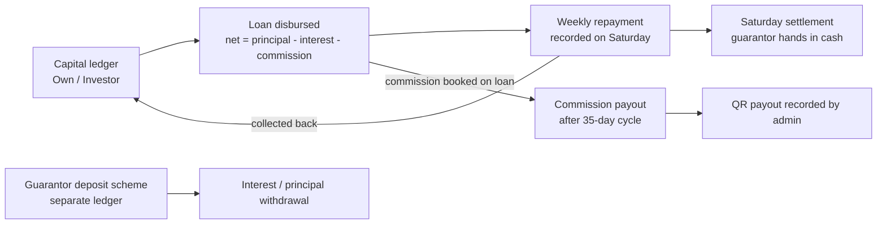

# Money Brain
**One-page map of how money moves in the NGF CRM: capital, loans, weekly collection, Saturday settlement, commission payout and the guarantor deposit scheme.**

Purpose: explain every rupee path and where the app calculates it. Amounts are strings in the DB and parsed with `Number(...)`.

## How money moves

## Five things to remember
1. Interest and commission are taken **upfront** at disbursement. Available Capital = capital - principal lent + collected (`app/api/capital/route.ts:29`).
2. Repayments are recorded in the UI only on Saturday (IST) unless a Dev flag unlocks it; the API itself does not enforce this. See [[Repayments and Collections]].
3. "Not Paid" is stored as status `Pending`; the form's UPI and Bank labels map to DB modes `UPI` and `Bank`.
4. Commission is earned per loan but only payable after a 35-day cycle; the QR scan path has a status-update bug. See [[Commissions and Payouts]].
5. Deposits are a separate scheme: 4% per 122-day cycle, ledger-based. See [[Deposits]].

## Notes in this section
| Note | What it answers | Read when |
|---|---|---|
| [[Repayments and Collections]] | How a weekly payment is recorded, IST dates, collection sheet | Touching Collection page or `/api/repayments` |
| [[Settlements]] | Cash due per guarantor, Settled vs Partial, QR payout rows | Changing Saturday cash handover |
| [[Commissions and Payouts]] | Commission cycle, request, approve, QR | Changing guarantor payouts |
| [[Deposits]] | Deposit ledger, interest rule, withdrawals | Changing deposit scheme |
| [[Capital and Dashboard Metrics]] | Every dashboard formula, capital, projection | Dashboard number looks wrong |
| [[Reports]] | Reports page tabs and data source | Changing reports |

## Known issues
- Commission QR scan sends PATCH without `action`; payout stays Pending. [[Commissions and Payouts]]
- `lib/financial.ts` reads camelCase keys from raw rows, so Financial Analytics is mostly empty. [[Capital and Dashboard Metrics]]
- Dashboard "Month Collected" card sums only 14 days. [[Capital and Dashboard Metrics]]
- Several money endpoints do no server-side role or date check. See [[Open Security Leads]].

## Update this section when ...
- Loan product numbers or upfront deductions change ([[Loan Products and Math]]).
- A new payment mode, repayment status or settlement status is added ([[Enums and Status Values]]).
- Cycle lengths (35-day commission, 122-day deposit) or the deposit rate change.
- A dashboard card or formula changes.

## Related
- [[00 BRAIN]], [[Lead to Loan]], [[Roles and Permissions]], [[Tables]], [[Data Access Layer]]
