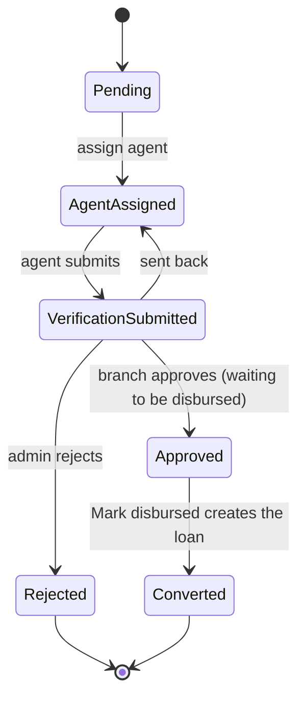
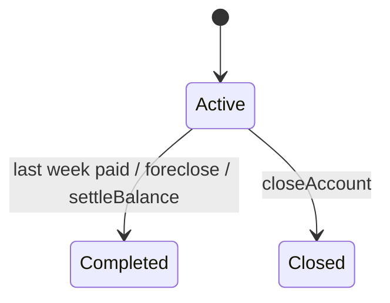
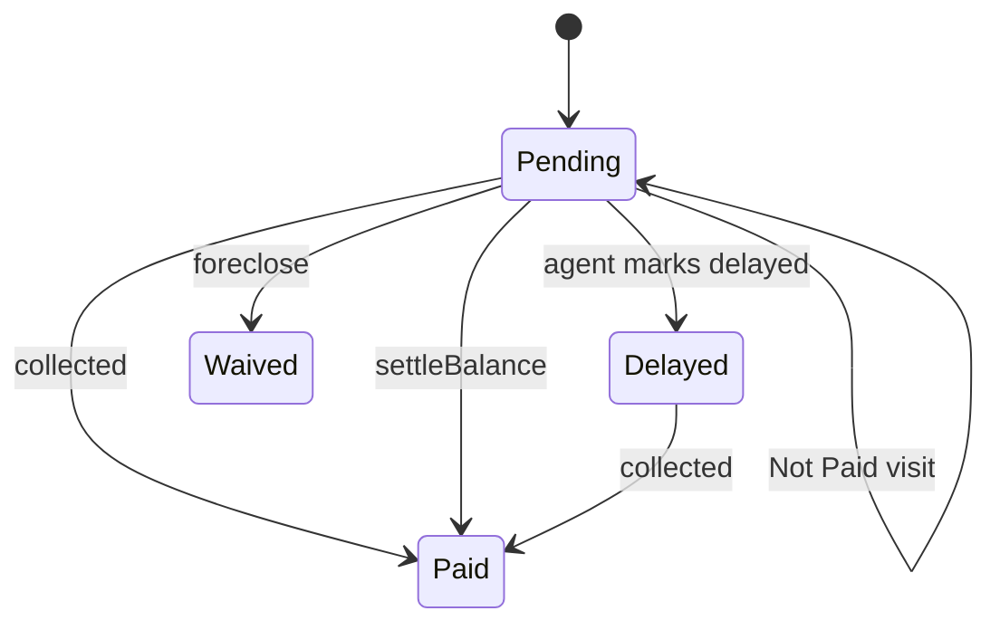
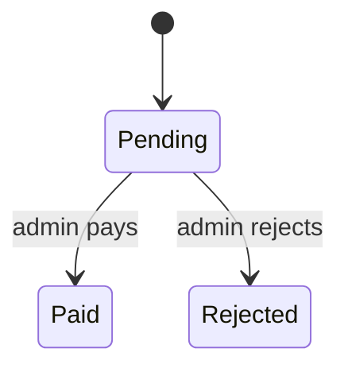

# Enums and Status Values
**One line: every live Postgres enum, where it is used, and how the code moves lead, loan, repayment and payout statuses.**

## Live enums (queried 2026-10-17)
| Enum | Values | Used by |
|---|---|---|
| user_role | Admin, Guarantor, Collection Agent, Staff, NGF AGENT | users.role, logs.role, notifications.role |
| user_status | Active, Inactive, Suspended, Deleted | users, agents, customers, guarantors, loan_products (.status) |
| agent_type | Field, Tele, Both, Verification & Collection | agents.agent_type |
| branch_status | Active, Inactive | branches.status |
| lead_status | Pending, Under Review, Agent Assigned, Verification In Progress, Verification Submitted, Approved, Rejected, Converted | leads.status |
| verification_result | Verified, Suspicious, Rejected Recommendation, Submitted | leads.verification_status |
| loan_status | Active, Completed, Defaulted, Settled, Closed | loans.status |
| repayment_status | Pending, Paid, Overdue, Delayed, Waived | repayments.status |
| payment_mode | Cash, UPI, Bank, Cheque, Other | repayments.payment_mode, collections.payment_mode |
| settlement_status | Pending, Completed, Partial, Settled | settlements.status |
| payout_status | Pending, Approved, Rejected, Paid | payout_requests.status |
| capital_type | Investment, Withdrawal, Profit, Loss, Own, Investor | capital.type |
| deposit_type | Commission, Capital, Refund, Other | deposits.type, deposit_requests.type |
| deposit_request_status | Pending, Approved, Rejected | deposit_requests.status |
| review_category | Document, Field, Financial, Other | review_options.category |

`supabase_schema.sql` lacks: NGF AGENT, Deleted, Verification & Collection, Submitted, Closed, Settled (settlement), Own, Investor. See [[Live vs Repo Drift]].

## How the code moves statuses
Lead (`app/api/leads/[leadId]/route.ts`): assign agent `:76`, agent submits `:134`, admin approve `:185`, reject `:196`, send back `:201`, convert `:404` and `:456`.

Loan (`app/api/loans/route.ts:81,113,127`, `repayments/route.ts:170`):

Repayment (`repayments/route.ts:104-140`, `loans/route.ts:86,111`):

Payout (`commissions/payout/route.ts:97,118`):

## Rules and gotchas
- Overdue is derived on read (`app/api/repayments/route.ts:39`), never written. Nothing writes `Defaulted`, `Approved` (payout) or lead `Under Review` / `Verification In Progress`.
- Settlements write `Settled` or `Partial` (`app/api/settlements/route.ts:68,92`).
- Known issue: `app/api/deposits/request/route.ts:94` writes request status `Paid`; enum has only Pending/Approved/Rejected. Together with the type mismatch, creating and approving withdrawal requests would fail on insert.
- Known issue: `lib/deposits.ts:4-6` ledger types (`Deposit`, `Interest Payout`, `Principal Withdrawal`) and request types `Principal`/`Interest` (`deposits/request/route.ts:36`) are not in `deposit_type`.
- `loan_products` uses `user_status`; delete is soft: `Status = 'Deleted'` (`app/api/loan-products/route.ts:109`).
- `agent_attendance.status` and `branch_staff_roles.role_in_branch` are plain text, not enums (roles: manager, accountant, cashier, collection_agent).
- New enum values: `ALTER TYPE ... ADD VALUE` is one-way; see [[Migrations]].

## Related
- [[Tables]], [[Lead to Loan]], [[Repayments and Collections]], [[Commissions and Payouts]], [[Deposits]], [[Settlements]], [[Database Brain]]
