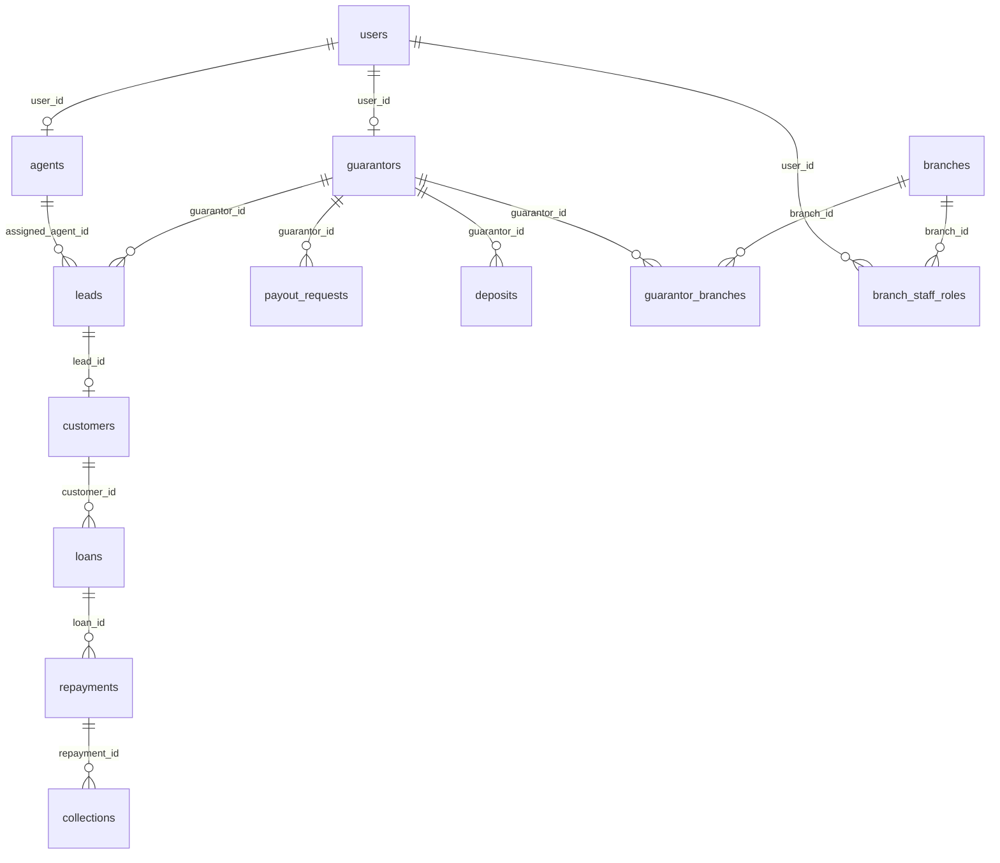

# Tables
**One line: all 27 live public tables with keys, foreign keys (delete rule) and the code that uses them.**

Verified live 2026-10-17. PK is text unless noted. "No action" = FK with no delete rule (delete is blocked while children exist). Code reads/writes via `lib/supabase-db.ts` (`readTable`, `appendRow`, `updateById`); "Route" names are folders under `app/api/`. See [[Data Access Layer]].

## ERD (core)

## People
| Table | Purpose / key columns | FKs (delete rule) | Used by |
|---|---|---|---|
| users | Logins: username (unique), password_hash, salt, role, status, email, guarantor_code, blocked_at/until/by, block_reason. PK user_id | blocked_by -> users (no action) | auth/*, staff, staff/block, profile |
| guarantors | Guarantor profile: code, commission_earned, status. PK guarantor_id | user_id -> users (CASCADE) | staff, leads, loans, dashboard, deposits |
| agents | Field agents: agent_type, status, GPS (latitude, longitude, location_accuracy, location_updated_at, is_tracking), branch_id. PK agent_id | user_id -> users (CASCADE); branch_id -> branches (SET NULL) | staff, agent/*, leads |
| profiles | ID-card extras: photo, blood_group, emergency_contact, place, card_number. PK user_id | user_id -> users (CASCADE) | profile, branches/org-hierarchy |
| customers | Borrower: contact, bank, pan, active_loan_id, status. PK customer_id | lead_id -> leads (CASCADE); guarantor_id -> guarantors (no action) | customers, leads/[leadId], import-customer |

## Leads and loans
| Table | Purpose / key columns | FKs (delete rule) | Used by |
|---|---|---|---|
| leads | Application + KYC + photo URLs, loan_product, status, verification_status, assigned_agent_id. PK lead_id | guarantor_id -> guarantors; guarantor_user_id -> users (no action); assigned_agent_id -> agents (SET NULL) | leads, leads/[leadId], dashboard |
| loan_products | Product templates: principal, duration_weeks, weekly_collection, total_collection, interest_deduction, guarantor_commission, net_disbursed. PK key | none | loan-products, `lib/loanProducts.ts` |
| loans | Issued loan: amounts, weeks, start/end dates, status. PK loan_id | customer_id -> customers (CASCADE); lead_id, guarantor_id (no action); assigned_agent_id -> agents (SET NULL) | loans, leads/[leadId], projection |
| repayments | One row per week: due_date, week_no, amount, status, paid_date, payment_mode, proof_file_id. PK repayment_id | loan_id -> loans (CASCADE); customer_id (no action); collection_agent_id -> users (no action) | repayments, collection-sheet, loans |
| review_options | Dropdown labels for visits. PK option_id | none | review-options, `lib/reviews.ts` |

## Money
| Table | Purpose / key columns | FKs (delete rule) | Used by |
|---|---|---|---|
| collections | Cash-in ledger row per paid repayment. PK collection_id | repayment_id -> repayments (CASCADE); loan_id, customer_id (no action); agent_id -> users (no action) | repayments, collections, settlements |
| settlements | Handover records: entity_type/id, total_cash_due, total_upi_due, amount_submitted, balance, saturday_date. PK settlement_id | recorded_by -> users (no action) | settlements, settlements/due |
| payout_requests | Guarantor commission payouts. PK payout_id | guarantor_id -> guarantors (no action) | commissions/payout |
| deposits | Guarantor deposit ledger (type, amount, date, recorded_by). PK txn_id | guarantor_id; recorded_by -> users (no action) | deposits, deposits/request |
| deposit_requests | Withdrawal requests. PK request_id | guarantor_id -> guarantors (no action) | deposits, deposits/request |
| capital | Investor/own capital entries. PK capital_id | none | capital, financial-analytics, projection |

## Field and org
| Table | Purpose / key columns | FKs (delete rule) | Used by |
|---|---|---|---|
| branches | Branch list. PK branch_id | none | branches, org-hierarchy |
| staff_access | Per-branch permissions (array). PK (user_id, branch_id) | user_id -> users (CASCADE); branch_id -> branches (CASCADE) | branches, org-hierarchy |
| branch_staff_roles | Role in branch (manager, accountant, cashier, collection_agent), is_active. PK id uuid. Unique: one active manager per branch | user_id -> users (CASCADE); branch_id -> branches (CASCADE) | staff, branches, org-hierarchy |
| guarantor_branches | Guarantor to branch link, is_active. PK id uuid, unique (guarantor_id, branch_id) | guarantor_id -> guarantors (CASCADE); branch_id -> branches (CASCADE) | staff, branches, org-hierarchy |
| agent_trips | Trip distance per lead. PK trip_id | agent_id -> agents (CASCADE); lead_id -> leads (no action) | agent/trips |
| agent_attendance | One row per agent per day (unique agent_id+date), status text. PK attendance_id | agent_id -> agents (CASCADE) | agent/attendance |

## System
| Table | Purpose / key columns | FKs (delete rule) | Used by |
|---|---|---|---|
| settings | Key/value config. PK key | none | settings, auth/login, `lib/deposits.ts` |
| notifications | In-app messages by user and role. PK notification_id | user_id -> users (CASCADE) | notifications, `lib/notifications.ts` |
| logs | Audit trail with metadata_json. PK log_id | user_id -> users (SET NULL) | `lib/audit.ts` |
| migration_log | Drive-to-Supabase file migration log. PK log_id | none | `app/api/dev/migrate-*` only |
| password_reset_otps | Hashed email OTPs (attempts, expires_at, consumed_at, email_status). PK id uuid | user_id -> users (CASCADE) | `lib/otp.ts`, auth/forgot, verify-otp, reset |

## Rules and gotchas
- Deleting a user cascades to guarantors, agents, profiles, staff_access, branch roles, notifications and OTPs, but a guarantor with linked leads, customers or loans is refused by the route (`app/api/staff/route.ts:317-340`), then child rows are deleted explicitly (`:347+`).
- Money columns are `numeric`; lead_id/guarantor_id and similar references are plain text.
- `leads.recommendation_status` and `admin_final_decision` are text, not enums.

## Payment matching tables (added 2026-10-18, migration `2026-10-18-payment-matching.sql`)
| Table | Holds |
|---|---|
| `payment_groups` | One payment: UTR, mode, total, `status` (Verified / Flagged / Overridden), marker, screenshot |
| `payment_lines` | The customers/repayments a payment covers; `repayment_id` unique |
| `payment_events` | History: created, flagged, UTR edits, override, discard |
| `bank_transactions` | Uploaded bank-statement credits, `utr` unique |
| `customers.pay_code` | 4-digit code, unique per guarantor |

See [[Payment Matching]].

## Related
- [[Database Brain]], [[Enums and Status Values]], [[Live vs Repo Drift]], [[Queries We Use]], [[Branches and Staff]], [[Lead to Loan]]

## Verification routes (2026-10-19)
`leads` gained `visit_lat/lng/place/date/window/note`, `call_outcome`, `visit_status`, `route_seq`, `route_pin`, `leg_km`, `leg_min`. New `route_plans` (PK agent_id + plan_date) and `route_dist_cache` (PK pair_key). See [[Verification Day Routes]].

## Loan account number (2026-10-19)
`loans.loan_account_no` (NGF000001 style, sequence `loan_account_seq`, unique). `loans.customer_id` is no longer unique: a customer can have many loans. See [[Customer History and Score]].
